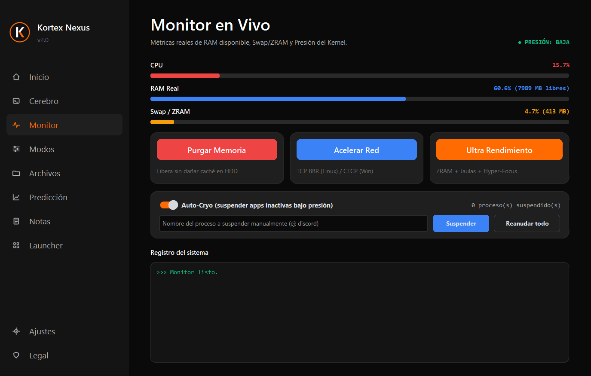
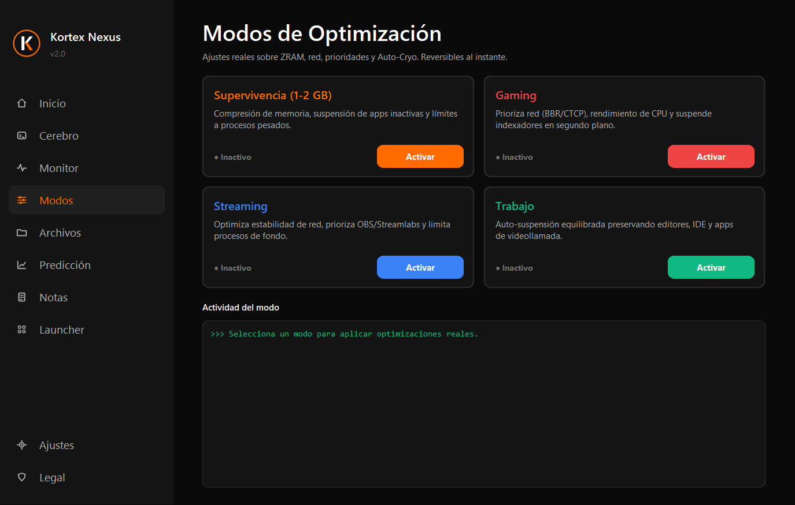
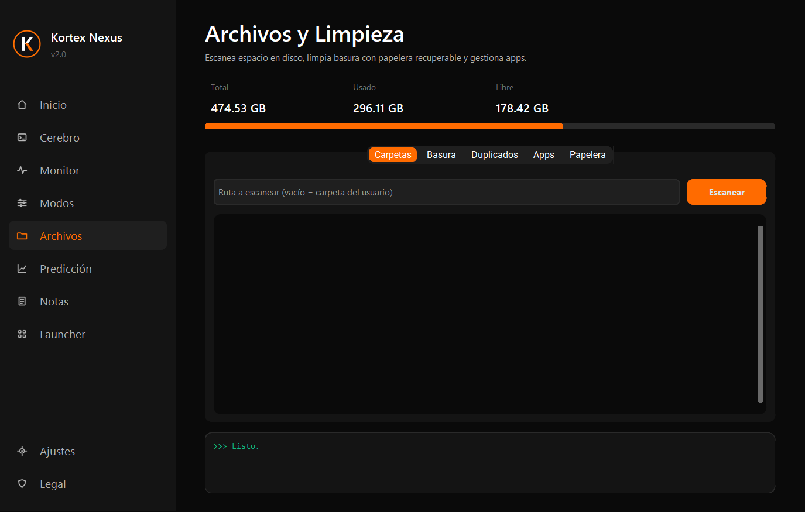
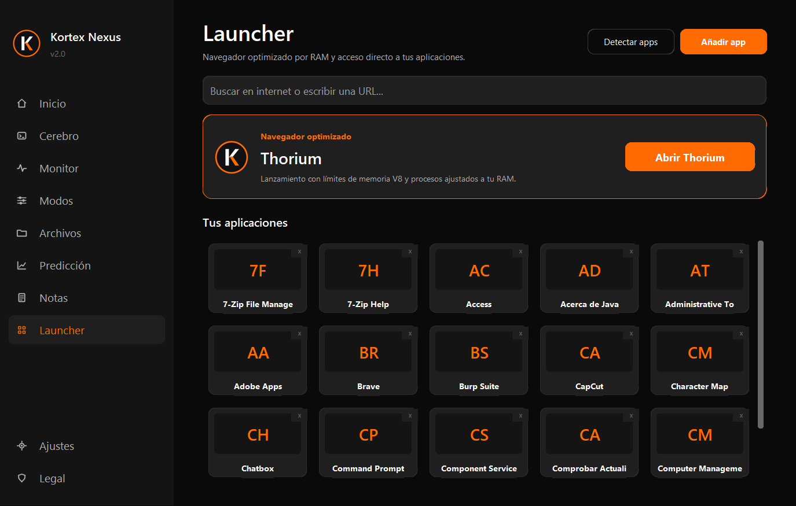

<div align="center">
  
  <h1>Kortex Nexus</h1>
  <p><strong>Optimizador de sistema y gestión de recursos 100% offline para equipos de bajos recursos (1 GB – 2 GB+ RAM).</strong></p>

  <p>
    <a href="https://github.com/ortiz10m/KortexNexus/releases/tag/v2.0.0">
      
    </a>
    
    
    
    
  </p>

  <p>
    <a href="#instalación">Instalación</a> ·
    <a href="#capturas">Capturas</a> ·
    <a href="#por-qué-kortex-nexus">Filosofía</a> ·
    <a href="#consejos-para-pcs-de-12-gb-ram">Consejos 1-2 GB</a> ·
    <a href="SECURITY.md">Seguridad</a>
  </p>
</div>

---

## Descarga directa (v2.0.0)

| Plataforma | Paquete | Tamaño | Instalación |
| :--- | :--- | :---: | :--- |
| **Windows (7 / 8 / 10 / 11)** | [KortexNexus-v2.0.0-Windows.zip](https://github.com/ortiz10m/KortexNexus/releases/download/v2.0.0/KortexNexus-v2.0.0-Windows.zip) | 22.5 MB | Descomprimir y abrir `install_windows.bat` (asistente gráfico) |
| **Linux (todas las distros)** | [KortexNexus-v2.0.0-Linux.tar.gz](https://github.com/ortiz10m/KortexNexus/releases/download/v2.0.0/KortexNexus-v2.0.0-Linux.tar.gz) | 575 KB | 1 comando en terminal (Debian, Ubuntu, Loc-OS, Arch, Fedora, openSUSE, Alpine, Void) |

---

## Capturas

### Monitor en vivo y suspensión inteligente (Auto-Cryo)
<p align="center">
  
</p>

### Modos de optimización reversibles
<p align="center">
  
</p>

### Archivos, papelera recuperable y Launcher
<table>
  <tr>
    <td></td>
    <td></td>
  </tr>
</table>

---

## Instalación

### Linux (Debian, Ubuntu, Loc-OS, Linux Mint, Arch, Fedora, openSUSE, Alpine, Void)
Funciona en **64-bit y 32-bit**, tanto en **X11 como en Wayland**, y detecta automáticamente `systemd` o `SysVinit` (como Loc-OS):

```bash
wget https://github.com/ortiz10m/KortexNexus/releases/download/v2.0.0/KortexNexus-v2.0.0-Linux.tar.gz && tar -xzf KortexNexus-v2.0.0-Linux.tar.gz && cd KortexNexus-v2.0.0-Linux && sudo ./install_linux.sh
```

*Instalación sin `sudo` (solo para tu usuario): reemplaza `sudo ./install_linux.sh` por `./install_linux.sh`.*

Comandos instalados:
- `kortex-nexus` — abre la interfaz gráfica.
- `kortex-daemon` — ejecuta únicamente el servicio ligero en segundo plano sin interfaz gráfica.
- `sudo /opt/kortex-nexus/uninstall_linux.sh` — desinstalación limpia.

### Windows
1. Descarga [KortexNexus-v2.0.0-Windows.zip](https://github.com/ortiz10m/KortexNexus/releases/download/v2.0.0/KortexNexus-v2.0.0-Windows.zip) y descomprime todo el contenido.
2. Haz doble clic en `install_windows.bat` para iniciar el asistente gráfico de instalación.
3. Si prefieres usarlo de forma portable, ejecuta directamente `KortexNexus\KortexNexus.exe`.

---

## Por qué Kortex Nexus

La mayoría de "optimizadores" comerciales recurren a acciones placebo (vaciar toda la caché en discos HDD lentos o mostrar barras falsas) que acaban empeorando la fluidez. Kortex Nexus trabaja sobre mecanismos reales del sistema operativo:

- **Lectura real de presión de memoria:** usa `mem.available` (nunca `mem.free`) y lee **PSI (`/proc/pressure/memory`)** en Linux para reaccionar a presión real antes de que el sistema entre en *thrashing*.
- **Auto-Cryo (suspensión por foco):** monitoriza la ventana activa (`Win32` en Windows, `xprop`/`xdotool` en X11, `hyprctl`/`swaymsg` en Wayland). Cuando hay presión de memoria, suspende procesos pesados inactivos en segundo plano y los **reanuda al instante** cuando vuelves a ellos o al cerrar Kortex.
- **Compresión de memoria real:** configura **ZRAM** (`zstd`/`lz4`) con `vm.page-cluster=0` y `vm.vfs_cache_pressure=50` en Linux, y verifica *Memory Compression* nativa en Windows.
- **Red y energía sin trucos:** activa `TCP BBR + fq` en Linux y `Set-NetTCPSetting` (con fallback a `netsh`) en Windows; ajusta `cpufreq` / `powercfg` según el modo.
- **Cero dependencias pesadas en predicción:** estima tendencia de RAM/CPU a 5, 15 y 30 min + tiempo estimado hasta saturación (TTC) con EWMA y regresión lineal ponderada en Python puro (sin `pandas` ni `scikit-learn`).
- **Limpieza segura:** todos los archivos eliminados por el usuario se mueven a una papelera interna con `manifest.json` recuperable durante 30 días, bloqueando rutas críticas del sistema y enlaces simbólicos.

---

## Consejos para PCs de 1–2 GB RAM

1. **Usa el servicio en segundo plano (`--daemon`):** en equipos con 1 o 2 GB, deja activo el daemon (`kortex-daemon` en Linux / `KortexNexus.exe --daemon` en Windows) y abre la interfaz gráfica únicamente cuando necesites revisar métricas, limpiar basura o cambiar de modo.
2. **En distros Linux sin `systemd` (como Loc-OS / Void / Alpine):** si quieres que ZRAM y TCP BBR se apliquen a nivel de kernel, lanza el daemon con `sudo kortex-daemon &` y abre la interfaz gráfica siempre **sin `sudo`** (`kortex-nexus`).
3. **Activa el modo `Supervivencia (1-2 GB)`:** combina compresión de memoria, Auto-Cryo más ágil y límites a procesos pesados en segundo plano; al desactivarlo o cerrar Kortex, todo vuelve a su estado original.
4. **Revisa `Archivos -> Basura` una vez por semana:** limpiar cachés de navegadores y temporales antiguos libera cientos de MB en discos pequeños sin tocar documentos personales.

---

## Arquitectura

```text
KortexNexus/
├── main.py                      # Punto de entrada (--daemon, --install, --clean-admin y GUI)
├── kortex_core/                 # Núcleo desacoplado (0 dependencias de GUI ni red)
│   ├── config.py                # Configuración atómica (~/.kortex_nexus/config.json) y autostart
│   ├── platform_hal.py          # HAL multiplataforma (RAM real, PSI, foco, disco, distros)
│   ├── cryo.py                  # Auto-Cryo por foco, lista blanca y Hyper-Focus reversible
│   ├── optimizer.py             # ZRAM, purga segura por tipo de disco, TCP BBR/CTCP, jaulas
│   ├── predictor.py             # Motor estadístico EWMA + regresión temporal + TTC
│   ├── sentinel.py              # Daemon unificado de telemetría y prevención
│   ├── modes.py                 # Modos reversibles (Supervivencia, Gaming, Streaming, Trabajo)
│   └── files.py                 # Escaneo, duplicados, apps multi-distro y papelera con manifest
├── kortex_ui/                   # Interfaz CustomTkinter thread-safe e instalador gráfico
├── modules/browser/             # Detección de navegador y flags de ahorro de RAM
├── packaging/                   # Spec PyInstaller, instaladores Windows/Linux y build_releases.py
└── tests/                       # 20 pruebas unitarias y auditoría estática de seguridad
```

---

## Desarrollo y pruebas

```bash
git clone https://github.com/ortiz10m/KortexNexus.git
cd KortexNexus
python -m venv venv
# Linux:   ./venv/bin/pip install -r requirements.txt
# Windows: .\venv\Scripts\pip install -r requirements.txt

# Ejecutar pruebas funcionales y de seguridad (20 tests)
python -m unittest discover -s tests -v

# Compilar paquetes de distribución en release/
python packaging/build_releases.py
```

Para detalles sobre auditoría de seguridad, cero fugas de datos y reporte de vulnerabilidades, consulta [SECURITY.md](SECURITY.md).

---

## Licencia y derechos de autor

**Copyright (c) 2026 David Santiago Ortiz Rincón. Todos los derechos reservados.**

Consulta el archivo [LICENSE](LICENSE) para los términos completos. El código fuente se publica con fines de transparencia, auditoría y portafolio; queda prohibida la redistribución comercial o venta sin autorización escrita del autor.
